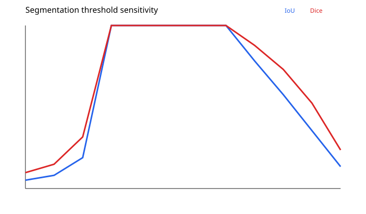

# Industrial Defect Segmentation

**An interpretable grayscale thresholding baseline for synthetic surface-defect masks**

  

## Overview

This repository is a minimal, fully reproducible image-segmentation example for industrial surface inspection. It constructs synthetic grayscale images with elliptical bright defects, applies a fixed pixel-intensity threshold, and evaluates predicted binary masks using **intersection-over-union (IoU)** and **Dice coefficient**.

**This is a classical image-processing baseline, not a trained U-Net or deep-learning segmentation model.** Its purpose is to verify image generation, segmentation, metric calculations, and output reporting.

## Dataset and segmentation

The seeded generator (`19`) produces **25 images of size 96 × 96**. Background intensities are sampled from **105–145**, while synthetic defect pixels are sampled from **190–235**. Each ground-truth mask indicates an elliptical defect against the background.

The decision rule is

$$\hat{M}(x,y)=\begin{cases}1,&I(x,y)\ge175,\\0,&\text{otherwise}.\end{cases}$$

IoU and Dice are computed between each predicted mask and the generated ground truth. A sensitivity sweep varies the threshold from **120 through 230 in steps of 10**.

## Reported synthetic-demo results

| Metric | Value |
|---|---:|
| Images | 25 |
| Mean IoU | 1.000 |
| Mean Dice | 1.000 |
| Operating threshold | 175 / 255 |



**Interpretation:** The intensity distributions do not overlap at the chosen threshold, so perfect overlap scores are expected. They do **not** indicate performance on real steel, glass, or production-line defects.

## Generated artifacts

- [`results/sample_ground_truth.pgm`](results/sample_ground_truth.pgm): Generated binary label mask.
- [`results/sample_prediction.pgm`](results/sample_prediction.pgm): Thresholded prediction.
- [`results/per_sample_metrics.csv`](results/per_sample_metrics.csv): Image-level segmentation scores.
- [`results/threshold_sweep.csv`](results/threshold_sweep.csv): Sensitivity experiment.
- [`results/metrics.json`](results/metrics.json): Aggregate metrics.

The sample images use portable graymap (`.pgm`) format, which preserves exact grayscale intensities; many viewers can open them directly.

## Limitations and next steps

The simple intensity distributions omit texture, illumination gradients, reflective surfaces, low-contrast defects, and labeling uncertainty. Next steps are labeled real images, part-independent data splits, U-Net-style segmentation baselines, per-class metrics and evaluation of inference latency.

## Reproduce the results

```bash
git clone https://github.com/nabinkandel07/Industrial-Defect-Segmentation.git
cd Industrial-Defect-Segmentation
python src/run_demo.py
python -m unittest discover -s tests -v
```

**Requirements:** Python 3.10 or later is recommended. The current demonstration uses only the Python standard library; no third-party dependencies are required.

## Repository structure

```text
.
├── src/run_demo.py       # Runnable demonstration
├── tests/test_demo.py    # Verification tests
├── docs/
│   ├── METHODOLOGY.md    # Model and experimental design
│   ├── RESULTS.md        # Result interpretation and limitations
│   └── DATA_DICTIONARY.md
├── requirements.txt
├── CITATION.cff
└── README.md
```

See the `results/` directory for the committed evaluation artifacts and figures, except the robotics repository, which uses `Results/`.

## Documentation and citation

Detailed assumptions and experimental settings are documented in [Methodology](docs/METHODOLOGY.md). See [Results](docs/RESULTS.md) for interpretation and [Data Dictionary](docs/DATA_DICTIONARY.md) for exported fields. Citation metadata is provided in [CITATION.cff](CITATION.cff).

## Author

**Nabin Kandel**  
Control Science and Engineering, Zhejiang Sci-Tech University  
[GitHub](https://github.com/nabinkandel07) · [Email](mailto:nabinkandel60@gmail.com)
